# Voronoi Analysis of Utility Services in Dhaka City

_Auto-generated by `python -m src.main`. All distances and areas are computed in the metric CRS (UTM zone 46N, EPSG:32646)._

## 1. Objective

Evaluate how accessible Dhaka's utility services are — metro stations, hospitals, water sources, fuel stations, bus stops and fire stations — by partitioning the city into Voronoi cells around each facility, measuring coverage gaps, and recommending where new facilities would most improve access.

## 2. Track A — textbook Voronoi (correctness proof)

Three hand-sketches (P.B, M.R, Phiruz) redrawn as mathematically correct Voronoi diagrams: seeds in general position, straight perpendicular-bisector edges, exactly three cells meeting at every vertex, cells tiling the box. The blue overlay proves one edge is the perpendicular bisector of its two seeds.

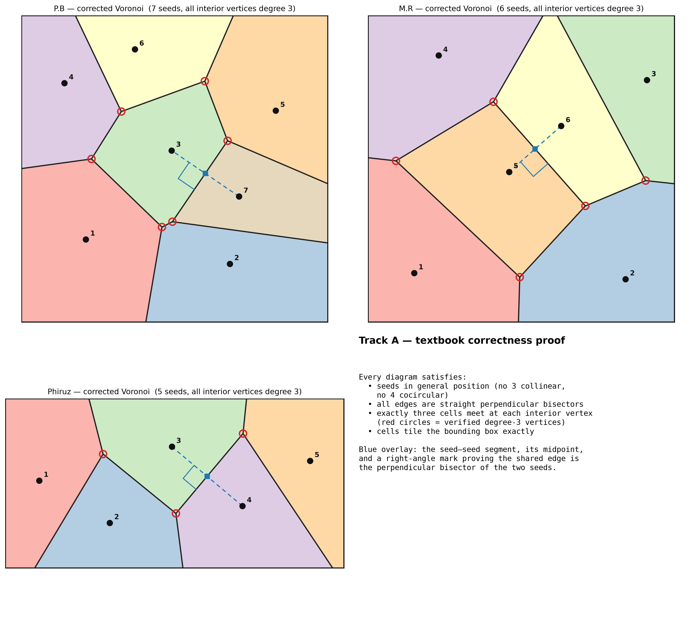

## 3. Method

- **Data**: OpenStreetMap POIs via `osmnx` inside the Dhaka bounding box `(90.33, 23.66, 90.5, 23.9)`; sparse categories fall back to labelled synthetic landmarks (see `data/SOURCE.md`).
- **CRS**: I/O in EPSG:4326; all geometry/maths in EPSG:32646 (metres).
- **Cleaning**: reproject, drop duplicates within 150 m, clip to the OSM admin boundary.
- **Voronoi**: exact half-plane clipping against Delaunay neighbours (every interior edge is a true perpendicular bisector), then intersected with the city boundary.
- **Metrics**: cell area (km²); nearest-facility distance on a 250 m grid (KDTree); a location is *underserved* if its nearest facility exceeds the per-service threshold; a cell is *underserved* if its area exceeds mean + 1σ. Access is area-weighted (no population raster).

## 4. Per-service coverage

| service       | label               |   n_facilities |   n_cells |   total_area_km2 |   mean_cell_km2 |   std_cell_km2 |   max_cell_km2 |   n_underserved_cells |   threshold_m |   mean_nn_m |   p90_nn_m |   max_nn_m |   pct_grid_underserved |
|:--------------|:--------------------|---------------:|----------:|-----------------:|----------------:|---------------:|---------------:|----------------------:|--------------:|------------:|-----------:|-----------:|-----------------------:|
| metro_station | Metro station       |             26 |        26 |              461 |          17.731 |         15.609 |         53.486 |                     4 |          2000 |      3563.6 |     7223.3 |    10163.6 |                   67.2 |
| hospital      | Hospital            |            286 |       286 |              461 |           1.612 |          4.295 |         47.059 |                    17 |          2000 |      1702.1 |     3950.1 |     8194.3 |                   32.7 |
| water_pump    | Water pump / source |            118 |       118 |              461 |           3.907 |          8.46  |         47.837 |                     9 |          1000 |      2800.6 |     6219.1 |    10866.3 |                   73.3 |
| fuel          | Fuel station        |            135 |       135 |              461 |           3.415 |          4.987 |         32.653 |                    14 |          1500 |      2166   |     5316.8 |    10111.8 |                   47.3 |
| bus_stop      | Bus stop            |            314 |       314 |              461 |           1.468 |          3.521 |         44.014 |                    15 |           800 |      1707.4 |     4316.4 |     9836.3 |                   57.1 |
| fire_station  | Fire station        |             22 |        22 |              461 |          20.954 |         14.939 |         56.813 |                     5 |          3000 |      2795.9 |     5125.8 |     7434.7 |                   41.4 |

### Metro station (`metro_station`)

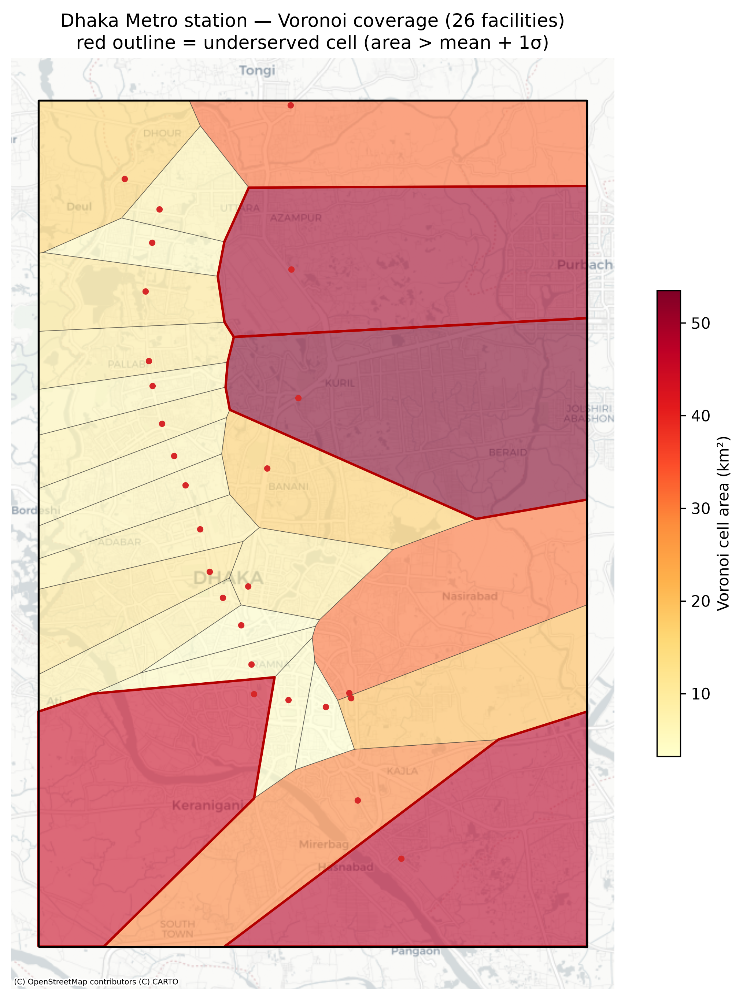

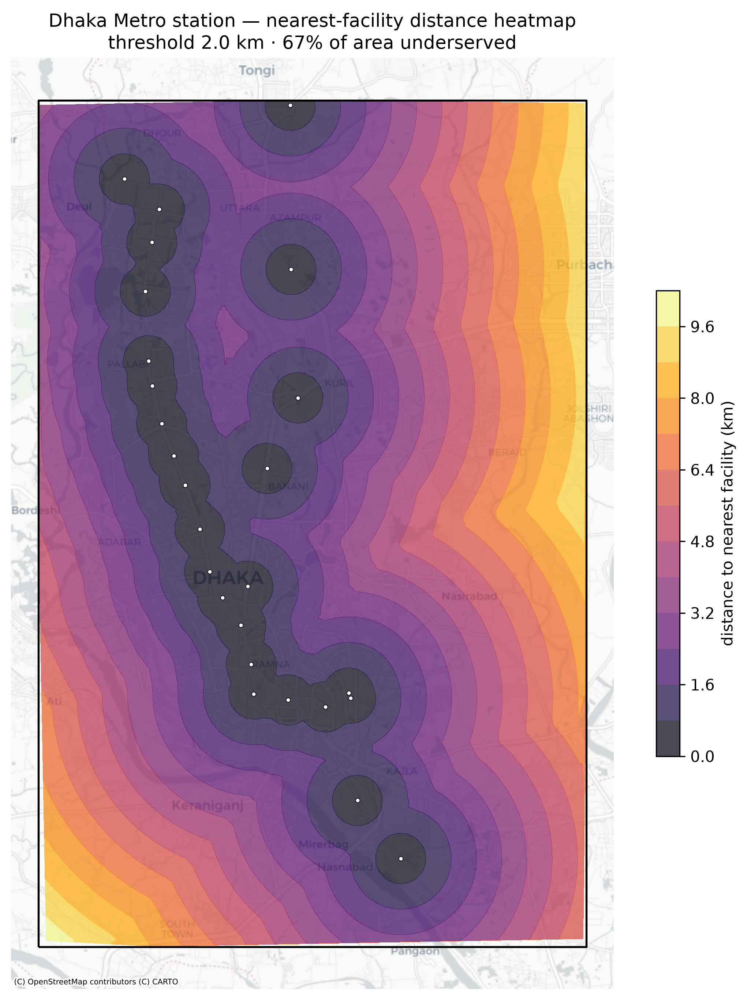

### Hospital (`hospital`)

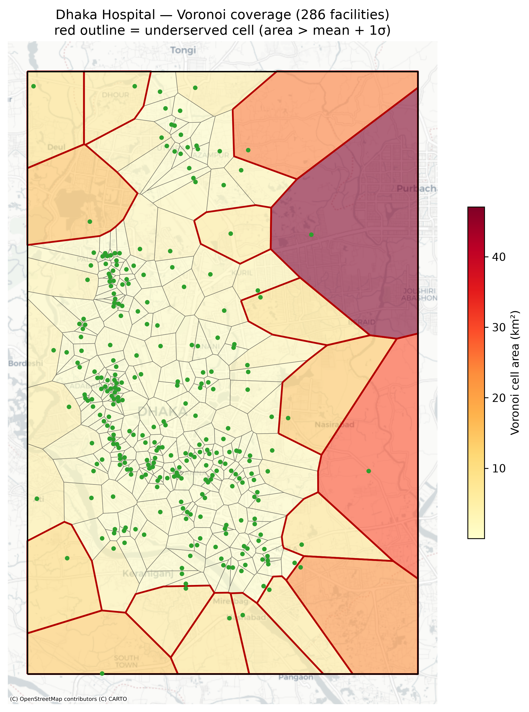

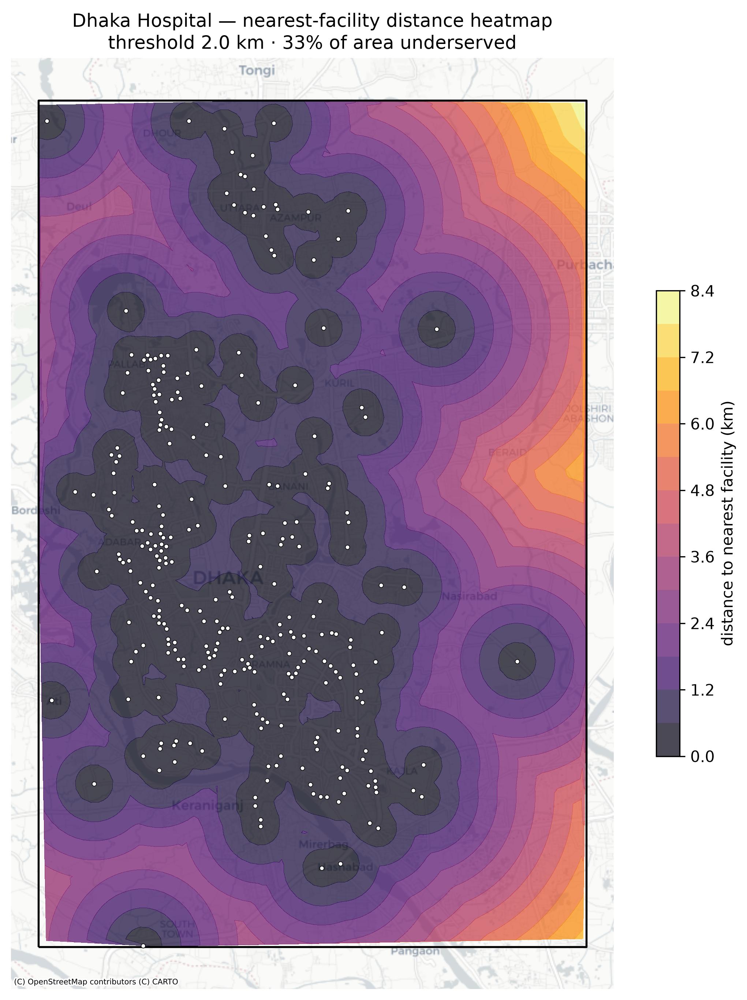

### Water pump / source (`water_pump`)

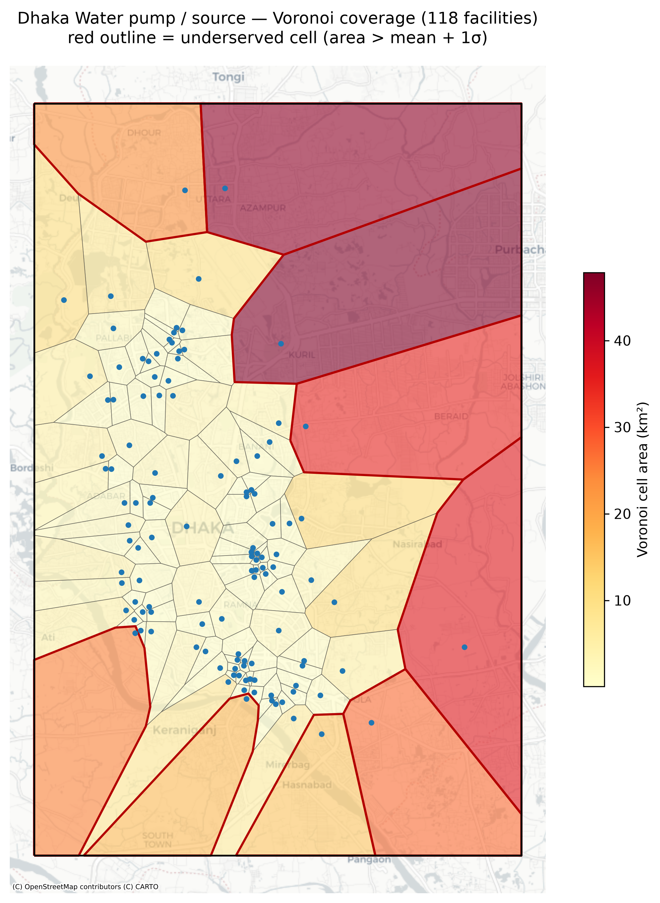

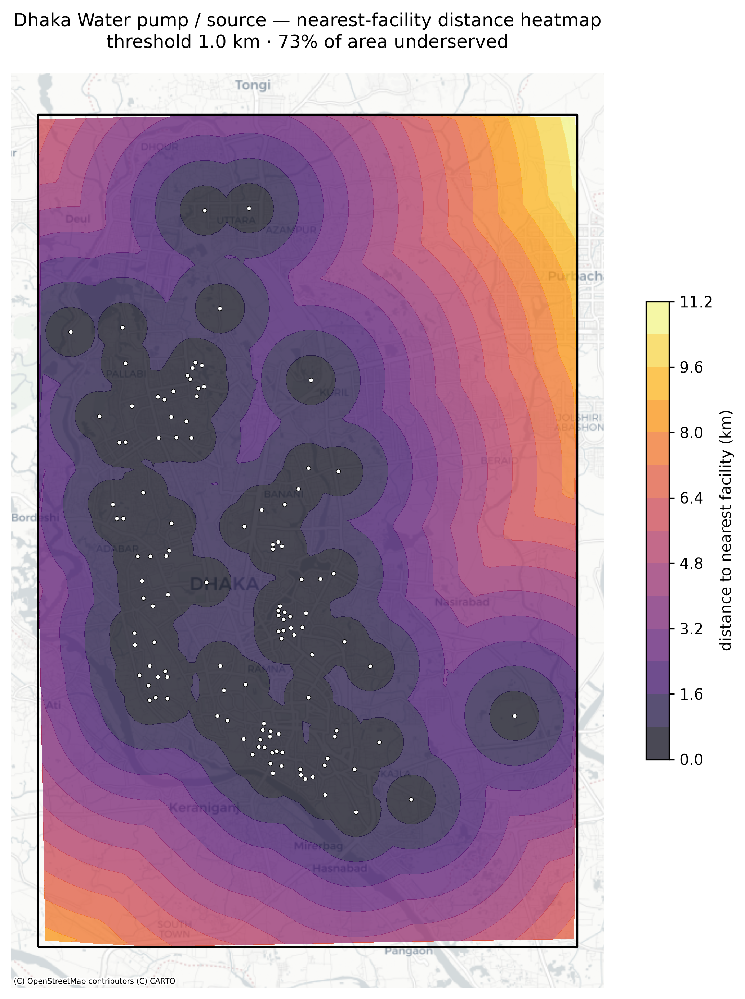

### Fuel station (`fuel`)

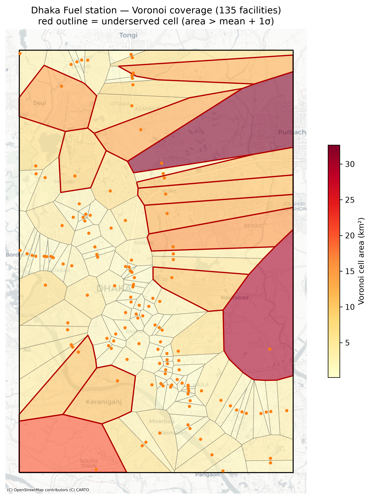

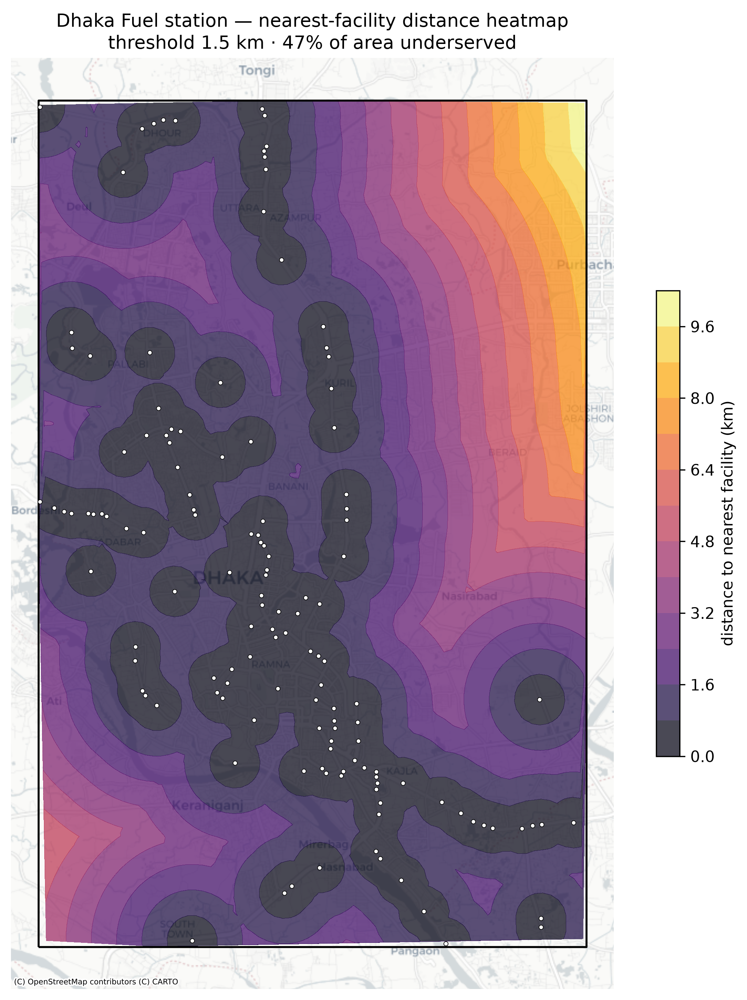

### Bus stop (`bus_stop`)

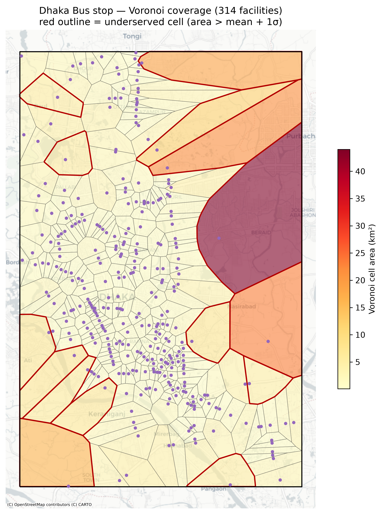

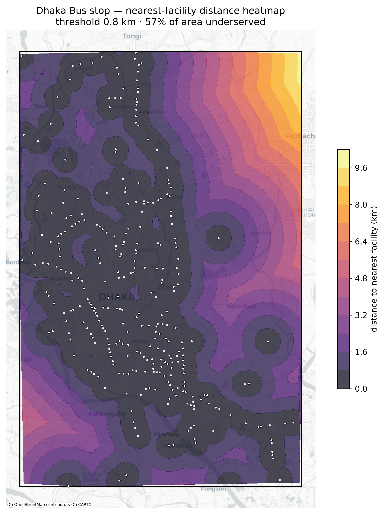

### Fire station (`fire_station`)

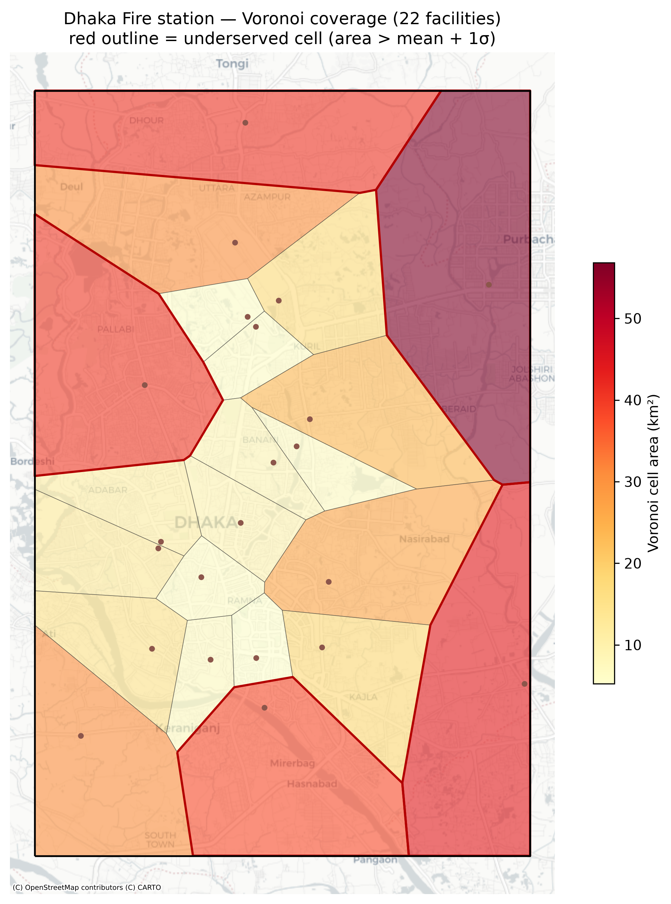

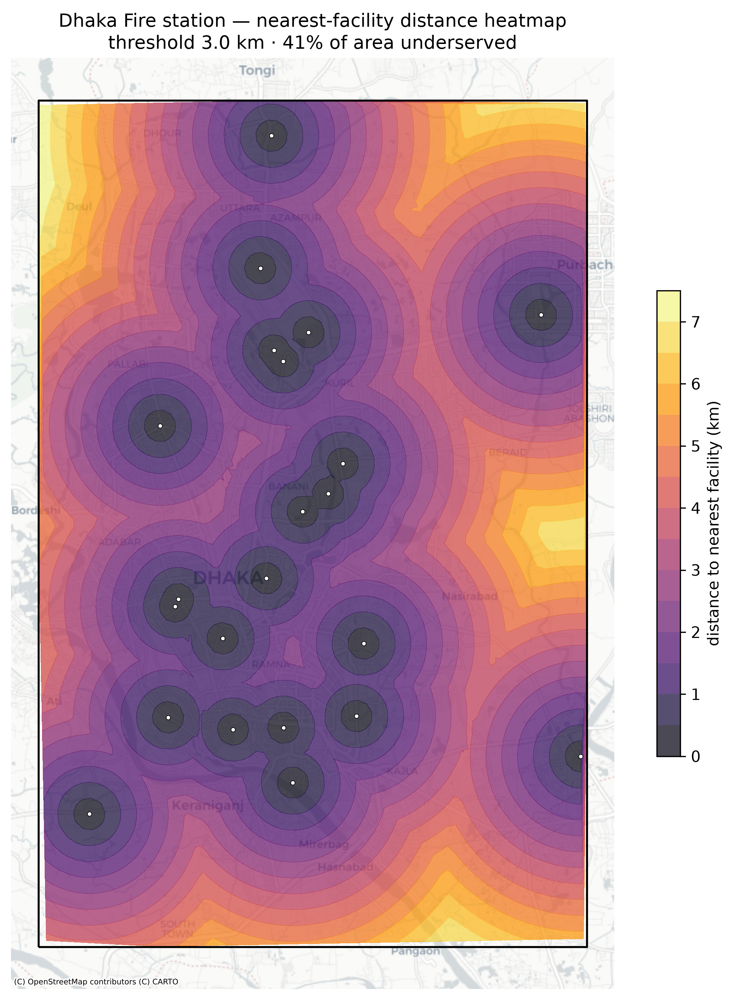

## 5. Underserved-area summary

- **Water pump / source**: 73.3% of the city is beyond the 1.0 km threshold; worst-served point is 10.9 km from any facility (9 oversized cells).
- **Metro station**: 67.2% of the city is beyond the 2.0 km threshold; worst-served point is 10.2 km from any facility (4 oversized cells).
- **Bus stop**: 57.1% of the city is beyond the 0.8 km threshold; worst-served point is 9.8 km from any facility (15 oversized cells).
- **Fuel station**: 47.3% of the city is beyond the 1.5 km threshold; worst-served point is 10.1 km from any facility (14 oversized cells).
- **Fire station**: 41.4% of the city is beyond the 3.0 km threshold; worst-served point is 7.4 km from any facility (5 oversized cells).
- **Hospital**: 32.7% of the city is beyond the 2.0 km threshold; worst-served point is 8.2 km from any facility (17 oversized cells).

## 6. Recommendations (greedy, before → after)

- **Metro station**: adding 3 sites cuts max access distance 10.16 km → 7.00 km and underserved grid points 4949 → 4681.
- **Hospital**: adding 3 sites cuts max access distance 8.19 km → 4.97 km and underserved grid points 2411 → 2188.
- **Water pump / source**: adding 3 sites cuts max access distance 10.87 km → 6.88 km and underserved grid points 5399 → 5336.
- **Fuel station**: adding 3 sites cuts max access distance 10.11 km → 5.48 km and underserved grid points 3488 → 3327.
- **Bus stop**: adding 3 sites cuts max access distance 9.84 km → 5.03 km and underserved grid points 4211 → 4130.
- **Fire station**: adding 3 sites cuts max access distance 7.43 km → 6.79 km and underserved grid points 3054 → 2361.

See `recommendations.md` for exact coordinates. Example map:

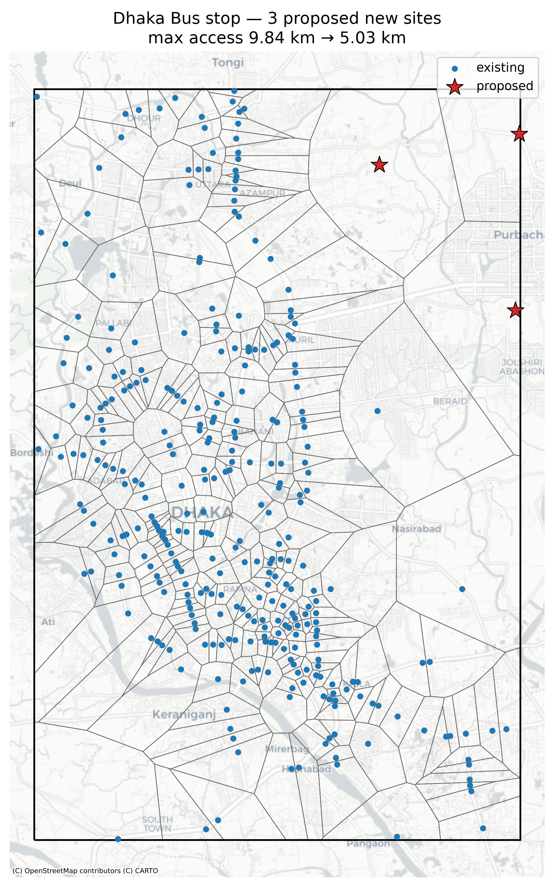

## 7. Track C — zone-coloured flagship map

The real service Voronoi, every cell coloured by the named Dhaka zone its seed falls in (nearest zone centre). Dashed lines are the coarse 8-zone Voronoi boundaries.

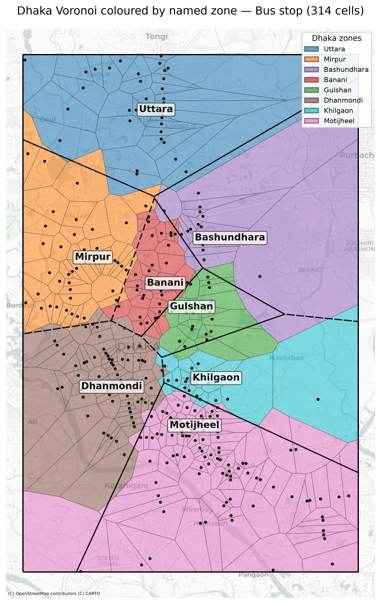

## 8. Limitations

- OSM completeness varies by category; counts are a lower bound.
- Sparse categories may include synthetic landmark points (flagged in `data/SOURCE.md` and the `source` column).
- Access is area-weighted, not population-weighted — underserved fringe areas (rivers, low-density edges) are counted equally with dense wards.
- The study window is the Dhaka bbox ∩ OSM admin polygon; peripheral cells extend to that boundary.

## 9. Reproducibility

```bash
python -m venv .venv && source .venv/bin/activate
pip install -r requirements.txt
python -m src.main      # regenerates data, figures and this report
pytest                  # correctness gates
```
